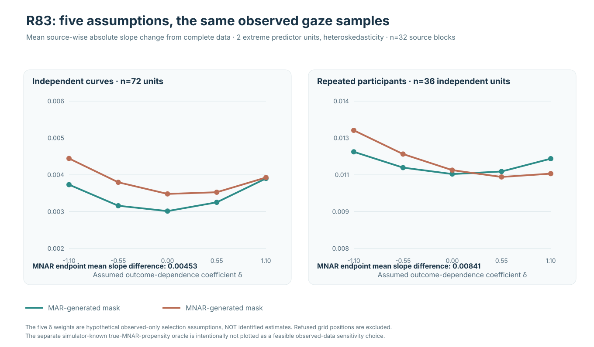
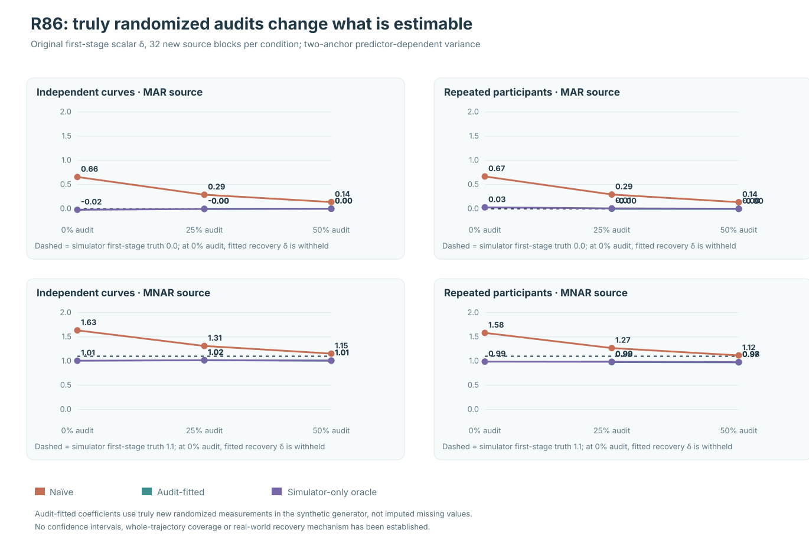

!!! success "Published stable release — 1.1.0"
    **1.1.0** is the current published stable release (Python 3.11–3.13). It preserves the 1.0 root API compatibility boundary and adds qualified sparse/irregular capabilities as stable **module-scoped 1.1 APIs**.

    ```bash
    pip install eyetrajectoriespy==1.1.0
    ```

!!! info "1.2 development — experimental source, not a published release"
    W1–W4 and all ten workflow contracts have passed installed-wheel product qualification. Frozen source **1.2.0rc1** remains unpublished. E1–E4 experimental interfaces were merged to protected `main` as **1.2.0rc2.dev0** under [PR #223](https://github.com/stefanosbalaskas/eyetrajectoriespy/pull/223), but a new literal RC2 has **not** been qualified or published. Publication remains disarmed. A plain PyPI installation still gives **stable 1.1.0**, without the 1.2 workflow APIs.

!!! warning "Research development is available separately from stable 1.1.0"
    [**Explore the 1.2 research evidence hub**](development/research-development-hub.md), including [original F1/F5/B6/B7 figures](development/research-original-figures.md), [simulation evidence and limitations](development/research-scientific-dashboard.md), and [source-code reproduction instructions](development/research-reproducibility.md). Research inference remains unqualified; these pages **do not** indicate that the experimental APIs are included in stable 1.1.0 or authorize a new package release.

<div class="et-hero" markdown>
<div markdown>

<!-- Protected-main experimental source version 1.2.0rc2.dev0; not a published release. -->

# Model the viewing process, not only its summaries

**Functional analysis of continuous, irregular and sparse eye-tracking trajectories in Python.**

Preserve the time-indexed planar gaze process rather than reducing every trial immediately to fixation counts:

$$
\mathbf G_i(t)=
\begin{bmatrix}
x_i(t)\\
y_i(t)
\end{bmatrix}.
$$

<span class="et-version-pill">stable 1.1.0 · 1.2 workflow RC qualification · Python 3.11–3.13</span>

[Install and get started](quickstart.md){ .md-button .md-button--primary }
[Choose an analysis](articles/choosing-the-ten-workflows.md){ .md-button }
[Explore figures](methods/visual-gallery.md){ .md-button }

</div>
<div markdown>


</div>
</div>

## New: what verified W3 simulation results tell us about inference


The independent R76/R76-A audit reconstructed **512 synthetic source cases** and **1,534,464 numerical maximum-statistic values**. In this Gaussian stress experiment, independently replicating influential predictor observations changed the observed inclusion of the true functional slope. These exploratory results **do not** establish nominal-90% simultaneous confidence-band calibration or qualify a new API.

[Scientific article: why functional bands under-cover](articles/when-w3-simultaneous-bands-undercover.md) · [R76 leverage article and figures](articles/how-independent-leverage-support-affects-coverage.md) · [Source-audit gallery](development/w3-r70-r76-evidence-plot-gallery.md)

### New R77 research: can regularization repair fragile functional covariance estimates?


An independent R77-A audit reproduced **256 new Gaussian datasets** and **1,278,720 maximum-statistic values**. Two prospectively fixed residual-covariance regularizations improved truth inclusion under concentrated high-leverage information, but **neither is qualified as a calibrated 90% confidence-band method**. Public 1.2 remains unreleased.

[Read the R77 article and see both plots](articles/covariance-regularization-and-w3-coverage.md)

### New: R78 temporal covariance robustness and independent numerical audit


The research programme has advanced to **R78/R78-A**, independently reconstructing **256 fully observed Gaussian source datasets and 1,278,720 maximum-statistic values**. The fixed positive-definite HC3 regularizations were challenged against a **time-scaled AR(1)** noise process without retuning. Their observed gains under high leverage persisted only partially; **no generally calibrated nominal-90% simultaneous inference is established**.

[Scientific study and original plots](articles/w3-temporal-covariance-robustness-r78.md) · [How to interpret independent source audits](articles/interpreting-w3-coverage-and-source-audits.md) · [Full R77–R78 figure ledger](development/w3-r77-r78-temporal-covariance-figure-ledger.md)

### New R79 research: nonseparable two-coordinate covariance stress


R79 and its separate R79-A audit reproduced **256 new source Gaussian trajectories and 1,278,720 raw maximum-statistic values** under a deliberately nonseparable spatial-temporal covariance law. Two frozen HC3 regularizations retained model-conditional improvements under severe predictor leverage, yet neither demonstrates generally valid nominal-90% simultaneous inference. **No experimental estimator has been promoted to the public package.**

[Read the R79 research article](articles/w3-nonseparable-coordinate-covariance-r79.md) · [View the source and figure gallery](development/w3-r79-nonseparable-covariance-evidence-ledger.md) · [Understanding two-dimensional dependence](articles/understanding-nonseparable-gaze-covariance.md)

### New R80: independent-unit heavy tails challenge functional confidence bands


The programme has advanced to **R80**, with **256/256 new Student-t5 source cases** and **1,278,720 original conditional maximum-statistic values** independently replayed. In the difficult two-anchor heteroskedastic design, frozen λ=.50 regularization included the entire slope in **23/32 independent curves and 24/32 repeated-participant source datasets**. The source-known *Student-t5 mixture*, not a Gaussian oracle, is simulation-only. These gains do **not** qualify general nominal-90% inference; version 1.2 remains on hold.

[Read the R80 research article](articles/w3-student-t5-heavy-tail-inference-r80.md) · [Why unit-level Student-t tails matter](articles/independent-unit-student-t-functional-uncertainty.md) · [Original R80 figure and source ledger](development/w3-r80-student-t5-evidence-ledger.md)

### R81: rare asymmetric unit contamination challenges simultaneous confidence bands


R81 tested **new independent-unit Student-t5 trajectories with centered asymmetric rare unit shocks**. Original and separately implemented audit jobs reproduced all **256/256 source cases and 1,278,720 reference maxima**. In the adverse two-anchor heteroskedastic setting, frozen λ=.50 includes the whole generating slope in **24/32 curves and 24/32 repeated participants**, still not validated nominal 90% inference. The true skewed reference exists only in the simulator. The stable API and version 1.2 release hold are unchanged.

[Read the R81 research article](articles/w3-skew-unit-contamination-r81.md) · [Methods companion](articles/independent-unit-skew-contamination-and-simultaneous-inference.md) · [Original figure/source ledger](development/w3-r81-skewed-unit-evidence-ledger.md)

### New R82: observation-dependent gaze loss and the limits of functional estimability


R82 independently verified **256 new complete source conditions and 1,024 paired complete/MCAR/MAR/MNAR observation masks**. With only two influential curve-level predictor units, **83.1% of gaze samples remain under MNAR**, yet an average **33.56 out of 62 slope-grid positions fail the preregistered independent-unit support gate**. The stable package correctly refuses incomplete inputs; naive pointwise available-case slopes are *research-only diagnostics*, not calibrated MNAR-adjusted confidence bands. Inference issues #289/#296 and version 1.2 release HOLD remain.

[Read R82 science and plots](articles/w3-response-dependent-gaze-loss-r82.md) · [Observation-process explanation](articles/independent-gaze-loss-and-pointwise-feasibility.md) · [Complete source evidence](development/w3-r82-observation-process-evidence-ledger.md)

### R83: missing-gaze selection is a sensitivity assumption, not an identified correction



The new R83 programme independently reconstructed **256 fresh synthetic X/Y source conditions, 1,024 paired complete/MCAR/MAR/MNAR masks and 3,328 pointwise sensitivity/oracle records**. Under two signed influential predictor units with heteroskedasticity, the original MNAR mask gives mean endpoint δ=-1.1 versus +1.1 **pointwise slope differences .00453 for curves and .00841 for participant units**, evaluated only at jointly estimable positions. These are **assumed selection models, not statistically identified MNAR correction or 90% confidence intervals**. Stable function-on-scalar regression still refuses missing gaze and v1.2 remains on hold.

[Read R83 scientific article](articles/w3-mnar-selection-sensitivity-r83.md) · [Methods companion](articles/independent-gaze-MNAR-sensitivity-and-selection.md) · [Original source and figure provenance](development/w3-r83-mnar-sensitivity-evidence-ledger.md)

### R84: what additional information could help identify outcome-dependent gaze loss?


R84 froze **256 new original synthetic source conditions, 512 paired MAR/MNAR missingness masks and 1,536 nested recovery evaluations**, then independently replayed the actual original immutable archive. With **0% independently recovered missing Y**, the selection coefficient is deliberately **not fitted**. Randomly recovering 25% or 50% of otherwise missing synthetic values permits estimating one **parametric scalar δ under frozen model and recovery assumptions**. It does **not** identify general real-gaze MNAR, justify imputation of lost values, or validate any simultaneous confidence band. Both W3 #289/#296 and version 1.2 release HOLD remain.

[Read the R84 scientific article](articles/w3-external-validation-mnar-identification-r84.md) · [External-validation methods](articles/external-gaze-validation-identifiability.md) · [Full independent source audit](development/w3-r84-validation-identification-evidence-ledger.md)

### R85: external gaze validation can itself be selective


R85 independently replayed **256 synthetic complete source conditions, 512 paired first-stage MAR/MNAR masks and 2,560 secondary ascertainment strategies**. When outcome-selective validation is treated as random, the adverse original MNAR δ=1.1 source produces mean δ **1.671 for independent curves**, versus **1.028 under a simulator-only true recovery-propensity oracle**. More importantly, the **original MAR δ=0** control can falsely appear outcome-dependent under the naïve recovery model. This is *not* an identified field-data MNAR correction or calibrated confidence band, and version 1.2 remains on HOLD.

[Read the R85 scientific article](articles/w3-biased-validation-mnar-r85.md) · [Selection-model companion](articles/secondary-validation-selection-and-mnar.md) · [Original immutable numerical and figure evidence](development/w3-r85-selection-validation-evidence-ledger.md)

### R86: independently auditing failures of a secondary validation process



R86 independently replayed **256 new complete synthetic source conditions, 512 first-stage MAR/MNAR masks and 4,608 third-stage audit/estimation records**. Under original MAR true delta=0, naïve weighting of an outcome-selective secondary validator gave fitted delta near **+.66** without an audit. A 25% randomized audit of failures allowed fitting a restricted secondary selection model and brought the first-stage mean close to zero in the simulated adverse sources. This requires **genuinely new randomly ascertained missing responses**; no real eye-tracker remeasurement capability, general MNAR identification or calibrated 90% confidence band is established. Version 1.2 remains unreleased.

[Read the R86 scientific article](articles/w3-random-audit-secondary-missingness-r86.md) · [Methods companion](articles/random-audit-of-validation-failures.md) · [Independent original source and figure ledger](development/w3-r86-third-stage-audit-evidence-ledger.md)

## See the methods

All plotted examples below use **deterministic synthetic data** and are regenerated from package code during the documentation build. They illustrate outputs and diagnostics, not human-subject findings.

<div class="grid cards et-gallery" markdown>

- **Functional principal components**

  

  Visualize a declared component/dimension of common-grid gaze variation.

  [FPCA workflow](workflows/fpca-exploration.md) · [Interpret the plot](articles/interpreting-workflow-figures.md)

- **Time-varying experimental effect**

  

  Inspect a declared predictor coefficient function over trial time.

  [Functional regression](workflows/experimental-functional-regression.md) · [Interpret the plot](articles/interpreting-workflow-figures.md)

- **Recurrence in state space**

  

  Display recurrence with analyst-declared embedding, lag, radius and Theiler window.

  [Recurrence workflow](workflows/nonlinear-recurrence.md) · [Interpret the plot](articles/interpreting-workflow-figures.md)

</div>

## The ten transparent workflows (1.2 candidate)

!!! warning "Candidate APIs are not installed by pip"
    The published stable `pip install eyetrajectoriespy` installs **1.1.0**, which does **not** include `run_sparse_mfpca_workflow()` or any other `run_*_workflow()` API. Those examples require the **1.2 candidate source**, not stable 1.1.


<div class="grid cards" markdown>

- **Five sparse routes**

  Native sparse FPCA/PACE, paired sparse planar MFPCA, asynchronous planar MFPCA, sparse multilevel decomposition, and partial-trajectory prediction.

  [Select a sparse route](articles/choosing-the-ten-workflows.md) · [Method validation](validation/one-dot-two-workflow-product-qualification.md)

- **Four dense/regression routes**

  Common-grid FPCA, function-on-scalar regression, functional mixed effects and generalized functional responses.

  [Compare assumptions](articles/choosing-the-ten-workflows.md) · [Workflow API](workflows/workflow-orchestration.md)

- **One recurrence route**

  Explicit state-space embedding, fixed-radius recurrence and RQA, with no automatic nonlinear-parameter tuning.

  [Recurrence guide](workflows/nonlinear-recurrence.md) · [Reporting decisions](articles/reproducible-workflow-bundles.md)

</div>

## Every analysis has an evidence trail


The audit layer distinguishes **analyst input**, **audited selectors**, **fixed workflow contracts** and **derived values**. Provenance counts above are descriptive illustrations of the candidate workflows, not comparative performance or methodological superiority.

[How to export an auditable bundle](articles/reproducible-workflow-bundles.md) · [Reproducibility checklist](reproducibility/checklist.md)

## Follow the scientific question

| Research aim | Default starting point | Main caveat |
|---|---|---|
| Dominant whole-path variation | [FPCA / MFPCA](workflows/fpca-exploration.md) | Component alignment and selection uncertainty |
| Sparse asynchronous x/y tracking | [Asynchronous MFPCA](guides/sparse-multivariate-async.md) | Preserve native coordinate-specific times |
| Effect of a condition over trial time | [Function-on-scalar regression](workflows/experimental-functional-regression.md) | Repeated-measures structure must be declared |
| Participant/trial heterogeneity | [Functional mixed effects](workflows/repeated-trial-mixed-effects.md) | Covariance and resampling assumptions |
| Binary or count functional outcome | [Generalized functional response](workflows/generalized-responses.md) | Explicit family, denominator or exposure |
| Temporal recurrence | [Recurrence/RQA](workflows/nonlinear-recurrence.md) | Strong dependence on embedding/threshold choices |

## Evidence before promotion

Scientific contracts, limitations, full qualification provenance, and a machine-checked public API boundary accompany the software. The [Bayesian B4 feasibility decision](articles/bayesian-feasibility-boundary.md) motivates a separate native research/design programme; it does **not** select a replacement estimator or make Bayesian inference a 1.2 production feature.

!!! important "Functional analysis complements event-based eye tracking"
    This package begins with a scientifically interpretable time/coordinate representation. It complements rather than replaces fixation, saccade, AOI-sequence, event detection and instrument-level QC workflows.

[Visual gallery](methods/visual-gallery.md) · [All workflows](workflows/index.md) · [Mathematical reference](methods/mathematical-reference.md) · [Public API](reference/api.md) · [GitHub repository](https://github.com/stefanosbalaskas/eyetrajectoriespy) · [PyPI](https://pypi.org/project/eyetrajectoriespy/)
