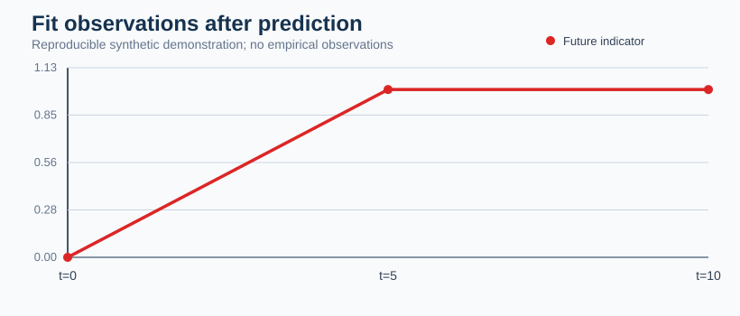
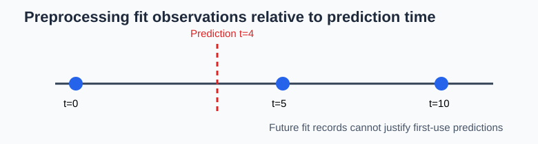

# Participant-disjoint does not mean deployment-valid preprocessing

**Experimental longitudinal transformation provenance, 21 October 2026.**

A held-out participant may be disjoint from training while a normalization procedure uses that participant's complete future recording. This can be legitimate for retrospective descriptive work, but is not valid evidence for first-use prediction.

The research-only `certify_preprocessing_availability()` consumes **actual fit-observation lineage**: transform ID, source participant and source time; plus prediction time, target participant and declared training participants. It cannot detect unrecorded internal uses of data.

## Synthetic falsification test

~~~python
import pandas as pd
from research.october_2026.information_availability import certify_preprocessing_availability

fits = pd.DataFrame({
    "transform_id": ["z"] * 3,
    "source_participant": ["heldout"] * 3,
    "source_time_s": [0, 5, 10],
})
predictions = pd.DataFrame({
    "transform_id": ["z"],
    "target_participant": ["heldout"],
    "prediction_time_s": [4],
})
audit = certify_preprocessing_availability(
    fits, predictions, training_participants=["train"], mode="online")
print(audit[["future_target_fit_uses", "deployment_valid"]])
~~~

The same logged observations may be disclosed as `retrospective`, in which case first-use validity is deliberately false.

## Plot recipe: time of information availability

~~~python
import matplotlib.pyplot as plt
fig, ax = plt.subplots(figsize=(6, 2.5))
ax.scatter([0, 5, 10], [1, 1, 1], s=100, label="Scaler fit observations")
ax.axvline(4, color="red", linestyle="--", label="Prediction at t=4")
ax.set(xlabel="Synthetic recording time", yticks=[], ylim=(0, 2))
ax.legend()
fig.tight_layout()
~~~

The certificate supports four declared regimes: population training statistics, prespecified prior baseline, online past-only normalization, and retrospectively fitted whole-recording normalization. It is not an independent audit of hidden vendor preprocessing, smoothing, imputation, subject identity correctness, or calibration quality. Those require independent tests and external evidence before release.

## Publication and scientific qualification boundary

This source-repository research method is **not** an installed public PyPI 1.2 API or an independent certificate of preprocessing validity. The illustrative figure is synthetic. Declared training/first-use source observations and future participant information must be validated against real preprocessing provenance before any prospective leakage-free claim. The [research-to-release issue](https://github.com/stefanosbalaskas/eyetrajectoriespy/issues/433) tracks independent empirical qualification. This article does not resolve the separate W3 Bayesian simultaneous-band calibration blockers and does not authorize an `eyetrajectoriespy 1.2` release.
