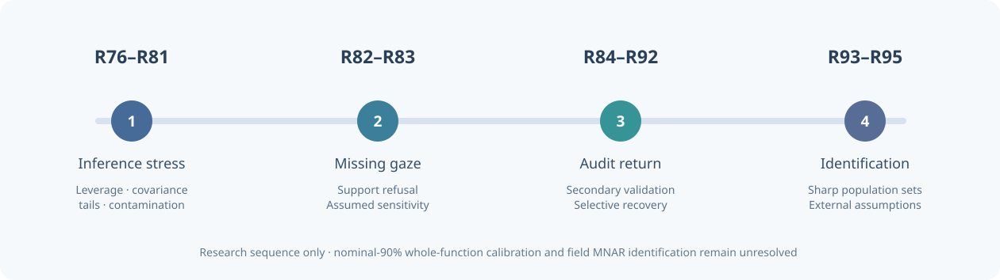

# W3 study map

The labels R76–R95 are **research stage identifiers**, not package versions, released modules or calibrated models.

| Series | Scientific question | Begin with |
| --- | --- | --- |
| **R76–R81 · Inference validity** | Does leverage, covariance choice, time dependence, heavy tails or contamination undermine whole-function inclusion? | [R76](../articles/how-independent-leverage-support-affects-coverage.md), [R78](../articles/w3-temporal-covariance-robustness-r78.md), [R80](../articles/w3-student-t5-heavy-tail-inference-r80.md), [R81](../articles/w3-skew-unit-contamination-r81.md) |
| **R82–R83 · Observed gaze** | Can a retained gaze fraction mask inadequate independent-unit support, and how do assumed MNAR mechanisms change sensitivity? | [R82](../articles/w3-response-dependent-gaze-loss-r82.md), [R83](../articles/w3-mnar-selection-sensitivity-r83.md) |
| **R84–R88 · Validation of missing outcomes** | When does genuinely new ascertainment help, and how can selective secondary return bias an audit? | [R84](../articles/w3-external-validation-mnar-identification-r84.md), [R85](../articles/w3-biased-validation-mnar-r85.md), [R86](../articles/w3-random-audit-secondary-missingness-r86.md), [R88](../articles/w3-r88-return-audit-sensitivity.md) |
| **R89–R92 · Bounds and randomized designs** | What can observable information and controlled audit assignment bound, without assuming guaranteed response? | [R89](../articles/w3-r89-sharp-observed-only-bounds.md), [R91](../articles/w3-r91-guaranteed-recovery-design-ht.md), [R92](../articles/w3-r92-near-complete-return-fragility.md) |
| **R93–R95 · Exact identification** | What remains unknowable under high response, and exactly which external guarantees or response-shape assumptions narrow the latent set? | [R93](../articles/w3-r93-exact-observed-law-nonidentification.md), [R94](../articles/w3-r94-external-audit-completion-bounds.md), [R95](../articles/w3-r95-monotone-audit-return-identification.md) |

*The arrows show the succession of questions; no stage in this diagram is a promotion of a failed procedure to the stable package.*

## Locate an original artifact

Evidence is indexed in the [research evidence dashboard](../development/research-scientific-dashboard.md). Individual [original-source figure ledgers](../development/research-original-figures.md) and study-specific original/independent records retain the exact datasets, denominators, simulation laws, failure counts and CI references. Start with [R93](../development/w3-r93-original-independent-equivalence-ledger.md), [R94](../development/w3-r94-original-independent-evidence-ledger.md) or [R95](../development/w3-r95-original-independent-evidence-ledger.md).

## Important boundary

No stage here claims successful general nominal-90% functional inference or observed-data identification of real-gaze MNAR. [Current release status](../news/release-status.md) and issues [#289](https://github.com/stefanosbalaskas/eyetrajectoriespy/issues/289) / [#296](https://github.com/stefanosbalaskas/eyetrajectoriespy/issues/296) take precedence over chronology.
